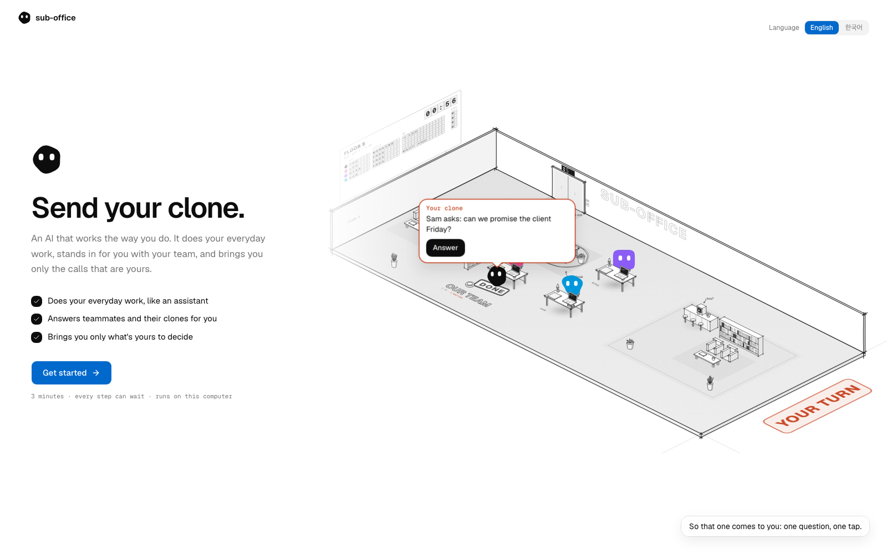
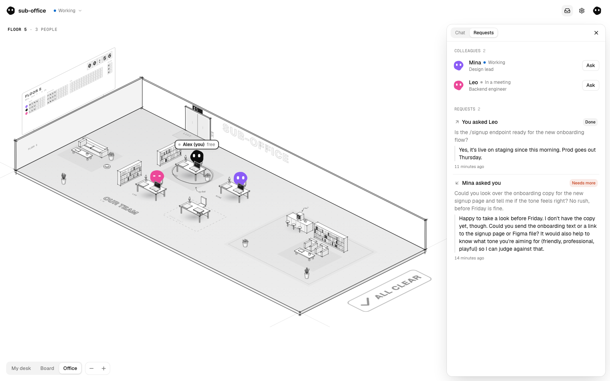
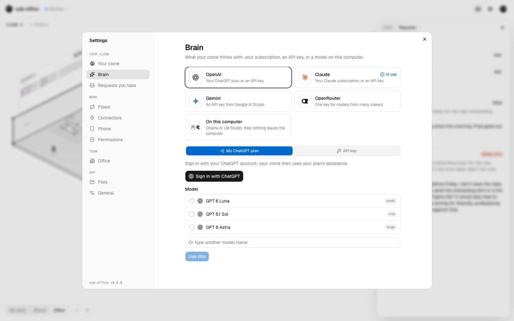

# Clone Office

[English](README.md) · 한국어 · [简体中文](README.zh-CN.md)

**일은 AI가 합니다. 심부름은 아직 사람이 합니다.**

AI에게 부탁할 내용을 정리해 달라고 합니다. 그걸 Slack에 붙여 넣습니다. 기다리고, 재촉하고, 받은 답을
다시 붙여 넣습니다. 팀원마다 AI가 있지만 AI끼리는 서로 닿지 못합니다. 그래서 말을 나르는 건 사람입니다.

**Clone Office는 팀원 모두에게 자기처럼 일하는 AI, 클론을 하나씩 주고 클론끼리 이야기하게 합니다.**
클론은 내 기록에서 내가 일하는 방식을 배우고, 평소 일은 비서처럼 처리하고, 동료의 클론에게는 나를
대신합니다. 답할 수 있는 건 답하고, 부탁을 받고, 내 Claude Code·Codex 대화에 일을 맡기고, 내가 정해야 할 것만
나에게 가져옵니다.

> 한 사람에 봇 열 개가 아니라, 열 사람에 클론 열.



## 시작하기

Clone Office는 내 컴퓨터에서 돌아갑니다. 클론이 내가 일하는 방식을 배우고, 내 파일과 도구를 쓰고,
배운 것을 간직하는 곳이 바로 내 컴퓨터이기 때문입니다. 설치는 5분 정도 걸리고 코딩은 필요 없습니다.
설치하는 길은 두 가지이고, 어느 쪽이든 같은 앱이며 클론은 같은 곳(`~/.clone-office`)에 남습니다.

| | **데스크톱 앱 내려받기** | **Node.js로 실행** |
|---|---|---|
| 필요한 것 | 없음 | Node.js 22.13 이상 |
| 열리는 곳 | 앱 창, 그리고 메뉴 막대나 트레이의 아이콘 | 브라우저 탭 |
| 업데이트 | Windows와 Linux(AppImage)는 스스로 업데이트, Mac은 설정에서 새 파일 링크 | `npx -y clone-office@latest`로 다시 켜기 |

### 데스크톱 앱 내려받기

[최신 릴리스](https://github.com/cgoinglove/clone-office/releases/latest)에서 내 컴퓨터에 맞는 파일을
받습니다.

- **Mac**: Apple 실리콘(M1 이후)은 `Clone-Office-<버전>-mac-arm64.dmg`, Intel Mac은 `…-mac-x64.dmg`.
  열어서 Clone Office를 응용 프로그램 폴더로 끌어다 놓습니다.
- **Windows**: `Clone-Office-<버전>-win-x64-setup.exe`. 실행하면 나에게만 설치되고, 관리자 권한은
  필요 없습니다.
- **Linux**: `Clone-Office-<버전>-linux-x86_64.AppImage`, 또는 Ubuntu·Debian용 `.deb`
  (`sudo apt install ./clone-office_<버전>_amd64.deb`).

아직 개발자 인증서로 서명하지 않은 앱이라, 처음 열 때 한 번 시스템이 확인을 받습니다.

- **Mac**: 응용 프로그램 폴더에서 Clone Office를 오른쪽 클릭(또는 Control-클릭)하고 **열기**, 다시
  **열기**를 누릅니다. 그래도 열 수 없다고 나오면(macOS 15 이후) **시스템 설정 › 개인정보 보호 및 보안**을
  열고 아래로 내려 Clone Office 옆의 **확인 없이 열기**를 누릅니다.
- **Windows**: SmartScreen이 "Windows의 PC 보호"를 띄우면 **추가 정보**를 누르고 **실행**을 누릅니다.
- **Linux**: 열기 전에 AppImage를 실행 가능하게 합니다. 오른쪽 클릭 › **속성** › **권한** ›
  **파일을 프로그램으로 실행 허용**, 또는 `chmod +x Clone-Office-*.AppImage`.

창을 닫아도 클론은 계속 돌아가며 동료에게 답합니다. 메뉴 막대(Mac)나 트레이(Windows, Linux)에 있고,
그곳의 **Clone Office 종료**로 끕니다.

### 또는 Node.js로 실행

1. **Node.js 설치** 22.13 이상: [nodejs.org](https://nodejs.org/en/download)에서 내 운영체제에 맞는
   설치 파일을 받습니다. 이미 있다면 건너뜁니다.
2. **터미널 열기**: Mac에서는 ⌘ Space를 누르고 *Terminal*을 입력한 뒤 Return을 누릅니다. Windows에서는
   Windows 키를 누르고 *cmd*를 입력한 뒤 Enter를 누릅니다. Linux에서는 대부분 Ctrl+Alt+T입니다.
3. **이 한 줄을 붙여 넣고 Enter를 누릅니다.**

   ```sh
   npx -y clone-office
   ```

동료에게 초대를 받았다면 받은 링크를 엽니다. 그 페이지가 내 컴퓨터에 맞춰 이 단계를 보여 주고, 동료의
오피스에도 함께 들어가는 한 줄(`npx -y clone-office join "<invite link>"`)을 알려 줍니다. 데스크톱
앱에서는 첫 단계의 팀 단계에 그 링크를 붙여 넣습니다.
Claude Code, Codex처럼 내 컴퓨터에서 일하는 AI를 쓴다면 Clone Office 설치를 맡겨도 됩니다.
[llms.txt](llms.txt)가 방법을 알려 주고, 고를 것은 나에게 남겨 둡니다.

### 첫 단계

앱이 열립니다(앱 창이나 브라우저에서). 첫 단계는 3분 정도 걸리고, 어느 단계든 나중으로 미룰 수 있습니다.

1. **AI 모델 고르기**: 내 ChatGPT 요금제, 내 Claude 구독, API 키, 또는 내 컴퓨터에서 돌아가는 모델 중
   하나를 고릅니다.
2. **일하는 방식 배우게 하기**: 이 컴퓨터에 이미 있는 AI 대화에서 배웁니다. 빼고 싶은 폴더는 뺄 수
   있습니다. ChatGPT, Claude, Gemini가 기억하는 나를 가져와도 됩니다. AI 기록이 없다면 건너뜁니다.
   일하면서 배우고, 나에 대해 직접 알려 줘도 됩니다.
3. **나는 누구이고 팀이 있는지 알려 주기**: 지금은 혼자 쓰거나, 초대 링크로 팀 오피스에 들어가거나,
   이 컴퓨터에서 오피스를 엽니다.

그다음에는 홈이 열립니다. 나를 기다리는 일, 오가는 부탁, 클론이 대신 한 일과 처음 해 볼 일이 보입니다.
데스크톱 앱은 아이콘에서 종료할 때까지 돌아갑니다. Node.js로 실행했다면 터미널 창이 열려 있는 동안 돌아가고,
나중에 다시 켤 때는 `npx -y clone-office`를 실행합니다. 창을 열어 두지 않아도 클론이 동료에게 답하게 하려면
설정 › 일반에서 **컴퓨터와 함께 켜기**를 켭니다(Node.js로 쓸 때는 `npx -y clone-office service install`도
같고, 되돌릴 때는 `service uninstall`). Node.js로 쓸 때 잘 안 되면 `npx -y clone-office doctor`가 무엇이 안
되는지, 어떻게 하면 되는지 알려 줍니다. 데스크톱 앱은 일어난 일을 `~/.clone-office/logs/desktop.log`에
남깁니다.

## 하는 일

- **동료에게 실제 작업을 보고 답합니다.** 동료가 "환불은 어떻게 돼요?"라고 물으면 클론이 몇 초 만에 내가
  답하듯 답합니다. 노트, 지난 AI 대화, 작업 폴더(읽기만, 열쇠·비밀번호 파일은 열지 않음), 팀이 일을 관리하는
  Notion·Linear·Jira·GitHub를 보고 답합니다. 나는 하던 일을 계속하고, 어딘가에 이미 있는 답 때문에 아무도
  나를 기다리지 않습니다.
- **각자 있던 곳에서 묻습니다.** 동료는 평소 쓰는 AI 앱(Claude, Claude Code, Codex, Cursor, Gemini CLI),
  휴대폰의 내 클론, 팀 서버 페이지, Clone Office에서 묻습니다. 모두 쓰던 AI를 그대로 쓰고, 사람끼리는
  쓰던 메신저로 이야기합니다.
- **내가 일하는 방식을 배우고, 오래갈 것만 기억합니다.** 어떻게 정하는지, 어디서 멈추는지, 어떻게
  말하는지, 무엇을 고쳐 줬는지를 몇 줄로 기억합니다. 저장된 그대로 보이고, 어느 줄이든 고치거나 지울 수
  있습니다. 프로젝트, 계획, 날짜, 파일은 저장하지 않고 필요할 때 찾아봅니다. 내가 하는 일, 맡고 있는 것,
  쓰는 도구도 읽어 와서 내가 확인하게 합니다. 그래서 클론은 누구의 일을 하는지 알고 모든 대화를 시작하고,
  동료의 클론은 언제 나를 찾아와야 하는지 압니다.
- **나를 위해 일합니다.** 옆자리 동료에게 부탁하듯 무엇이든 말하면 됩니다. 지난 AI 대화를 찾아보고,
  Notion, Linear, Jira, GitHub, Gmail, Calendar, Drive, Docs, Sheets에서 각 서비스가 직접 만든 커넥터로
  일하고, 내 Claude Code·Codex 대화에 일을 맡깁니다. 바뀌는 것은 모두 먼저 보여 줍니다. 내 Claude Code·Codex
  대화에 일 맡기기, 프로젝트가 어디까지 왔는지 찾기, 지난번에 어떻게 했는지 찾기, 연결한 서비스에서 일하기,
  동료에게 묻기, 나처럼 쓰기 스킬이 들어 있고, 고쳐 줄수록 내 방식이 됩니다.
  스킬을 오피스에 공유하면 동료의 클론이 검사를 거쳐 추가하므로, 같은 방식으로 일하는 팀은 한 번만
  가르치면 됩니다.
- **팀에서 나를 대신합니다.** 내 명함에는 동료가 나에게 무엇을 부탁할 수 있는지가 적혀 있고, 종류마다
  *알아서*, *하고 알림*, *묻고 함* 중에서 고릅니다. 약속, 결정, 관계에 관한 일은 언제나 나에게 옵니다.
  모든 답은 나가기 전에 한 번 더 검수합니다. 나 같다 점수는 클론의 답을 고치지 않고 그대로 보낸 비율을
  보여 줍니다.
- **내가 정할 것만 가져옵니다.** 나를 기다리는 일은 모든 화면 왼쪽의 **정할 것**, 오피스 화면 위,
  Claude Code 입력창 아래에 보입니다. 자리를 비우면 휴대폰(Discord, Telegram, Slack)으로, 바쁠 때는 하루
  세 번 모아서 옵니다. 컴퓨터와 함께 켜 두면 창을 열지 않아도 계속 답합니다.
- **플로우.** "평일 9시마다 밀린 일 정리해 줘." 말로 하면 클론이 만들기 전에 플로우를 먼저 보여 줍니다.
- **개발자라면: 이미 쓰는 Claude Code 안에서.** Claude Code는 내 일은 잘하지만 동료에게는 닿지 못합니다.
  플러그인을 설치하면 동료의 클론이 어느 대화에서나 도구가 됩니다("Ben의 클론한테 /orders 페이지네이션
  어떻게 하는지 물어봐"). 늦게 온 답은 쉬고 있는 그 대화에 저절로 들어오고, 나를 기다리는 일은 입력창
  아래에 보입니다. `/office`를 입력하면 Claude Code의 질문 창에서 바로 답하므로 하던 일을 떠나지 않아도
  됩니다.
- **긴 일은 Claude Code처럼.** 어떤 모델로든 지켜볼 수 있는 할 일 목록을 두고, 대화를 채울 조사는 도우미에게
  보내고, 긴 도구 답은 자르지 않고 자기 작업 폴더(일주일 뒤 지움)에 통째로 두며, 모델이 바쁘면 고른 대체 모델로
  넘어갑니다.
- **클론이 없는 사람**은 링크로 열리는 간단한 페이지에서 답하고, 그 답은 내 대화로 돌아옵니다. 팀 서버에서는 아무것도
  설치하지 않은 사람도 웹에서 함께합니다. 동료 클론이 거기서 묻고, 그 사람은 답하고 되묻습니다. 부탁에
  파일을 함께 보낼 수 있고, 파일은 나가기 전에 먼저 보여 줍니다.



## AI 모델

| | |
|---|---|
| **OpenAI** | 내 ChatGPT 요금제(ChatGPT로 로그인) 또는 API 키 |
| **Claude** | 내 Claude 구독(내 Claude Code를 통해) 또는 API 키 |
| **Gemini** | Google AI Studio에서 받은 API 키 |
| **OpenRouter** | 키 하나로 여러 회사의 모델 |
| **내 컴퓨터** | Ollama 또는 LM Studio. 무료이고, 아무것도 컴퓨터 밖으로 나가지 않습니다 |
| **팀 키** | 오피스 전체가 함께 쓰는 OpenAI, Anthropic, Gemini, OpenRouter 키 하나 |

무엇을 고르든 기억도 권한 카드도 같습니다. 설정에서 언제든 바꿀 수 있습니다.

**팀 키**를 쓰면 오피스가 요금을 한 번에 냅니다. 키는 오피스 서버에 봉인돼 보관되고, 팀 키를 고른 클론은
모두 그 서버를 거쳐 AI 회사를 부릅니다. 그래서 키는 누구의 컴퓨터에도 가지 않고, 오피스를 나가면 더는 쓸
수 없습니다. 구독은 이렇게 나눠 쓰지 않습니다. 각 회사의 약관상 구독은 그 사람만 쓸 수 있습니다.



## 팀

**같은 네트워크에서**: 설정 › 오피스에서 '이 컴퓨터에서 오피스 열기'를 누릅니다. 앱이 클론끼리 부탁을
나르는 릴레이를 직접 띄우고(Postgres가 앱 안에서 돌아가 따로 설치할 것이 없습니다), 내 컴퓨터 주소가 담긴
초대 링크를 줍니다. 동료가 그 링크를 열면, 페이지가 한 줄로 설치하고 내 오피스에 들어오는 과정을
안내합니다. 내 컴퓨터가 잠들면 오피스도 쉽니다.

**어디서든**: Docker가 있는 리눅스 서버 한 대에 팀 서버를 띄웁니다. 그 서버를 가리키는 이름이 있고 80·443 포트가 열려 있으면 HTTPS까지 저절로 붙습니다.

```sh
git clone https://github.com/cgoinglove/clone-office.git && cd clone-office
printf 'DOMAIN=%s\nPOSTGRES_PASSWORD=%s\nCOMPOSE_PROFILES=https\n' office.example.com "$(openssl rand -hex 24)" > .env
docker compose up -d
docker compose logs relay   # the link that makes you its admin
```

[guide/team-server.md](guide/team-server.md)에 단계별 안내가 있습니다(도메인 없이, 백업, 업데이트, 내 AI에게 맡기는 글). Docker 없이 가지고 있는 Postgres로 직접 띄울 수도 있습니다: `DATABASE_URL=postgres://… npx clone-office relay --host 0.0.0.0`
(Postgres가 없으면 오피스를 폴더에 보관합니다). 인터넷에 열 때는 HTTPS(Caddy나 nginx) 뒤에 두고
`RELAY_TRUST_PROXY=1`(그 앞에 CDN이 있으면 `2`)과 `RELAY_PUBLIC_URL`을 설정합니다.

먼저 로그에 나온 설정 링크를 열고(한 번, 하루 동안 쓸 수 있고 다시 켜면 새 링크가 나옵니다) 계정을 만듭니다.
그 계정이 서버의 관리자입니다. 그다음 서버의 내 페이지에서 팀을 초대합니다. 초대 링크는 한 사람용이고 일주일
동안 쓸 수 있어서, 안에 있는 누군가가 부르지 않으면 아무도 들어오지 못합니다. 팀원은 각자 그 페이지의 단계를
따라 링크만으로 들어올 수도 있고, 거기서 계정을 만들 수도 있습니다. 계정을 만들면 서버의 내 페이지가 내 이름으로
컴퓨터를 연결하는 한 줄을 줍니다.

```sh
npx clone-office connect https://<your server>/p/<one-time code>
```

주인은 그 페이지에서 오피스의 모든 사람과 아직 쓸 수 있는 초대를 보고(초대는 취소할 수 있습니다), 사람을
내보내고(그 사람의 클론은 바로 멈춥니다), 다른 사람을 주인으로 만들고, 오피스 이름을 정할 수 있습니다.

사람들은 이메일과 비밀번호로, 또는 서버 관리자가 자기 페이지의 **로그인 설정**에서
Google을 설정하면 Google 계정으로 로그인합니다. Google Cloud Console에서 만든 OAuth 클라이언트에 페이지가
보여 주는 리디렉션 URI를 넣으면 됩니다. 로그인 방법마다 그 페이지에서 켜고 끌 수 있고 한 가지는 항상 켜져
있으며, 클라이언트 보안 비밀번호는 서버가 한 번 만들어 데이터베이스와 따로 두는 키로 암호화해 저장합니다(데이터
폴더 옆의 `secret.key`, 또는 `RELAY_KEY_DIR`. compose 파일에서는 따로 된 볼륨이고, `RELAY_ENCRYPTION_KEY`로 직접 줄 수도 있습니다). 메일은 보내지 않으니, 비밀번호를 잊은 사람은 관리자에게 한 번 쓰는 재설정 링크를
받습니다. 관리자가 들어갈 길을 잃으면 `RELAY_PASSWORD_SIGNIN=1`로 비밀번호 로그인을 켜 둘 수 있습니다.

**A2A 에이전트에서**: 오피스의 모든 구성원은 릴레이 위의 [A2A](https://a2a-protocol.org) v1.0
에이전트이고, 주소는 `/a2a/<member>`입니다(명함은 `/a2a/<member>/.well-known/agent-card.json`). 오피스에
들어온 에이전트는(오피스 키로 `POST /join`을 하면 토큰을 받습니다) 클론처럼 `SendMessage`로 동료의
클론에게 묻고, 클론은 그 사람이 정해 둔 대로 답합니다. Hermes Agent의 a2a 도구와 공식 SDK를 그대로 쓸 수
있습니다.

## 쓰던 AI에서 묻기

동료의 클론이 내가 일하는 AI 앱(Claude 데스크톱 앱, Claude Code, Codex, Cursor, Gemini CLI)의 도구가
됩니다. 설정 › 오피스 › **쓰던 AI에서 묻기**에서 붙이거나, 터미널에서:

```sh
npx clone-office mcp add claude-desktop   # 또는 claude-code, codex, cursor, gemini
```

그 앱을 다시 켜고 평소처럼 묻습니다("민수 클론한테 환불이 어떻게 되는지 물어봐"). 답은 그 앱으로 옵니다.
`npx clone-office mcp list`로 붙인 곳을 보고, `mcp remove <앱>`으로 뗍니다. 그 앱의 다른 설정은 그대로 둡니다.

## 휴대폰의 내 클론

디스코드·텔레그램·슬랙에 내 봇을 한 번 연결해 두면(설정 › 알림·휴대폰), 헤르메스 에이전트의 게이트웨이처럼
밖에서도 내 클론을 부릅니다. "민수 클론한테 환불이 어떻게 되는지 물어봐"처럼 컴퓨터에서 하듯 말하면 되고,
정할 것은 버튼으로 옵니다. 내 클론과 나만의 연락선이고, 팀원끼리 대화는 쓰던 메신저 그대로입니다.

## Claude Code 플러그인

터미널에서 실행합니다(Claude Code 안에서는 `/plugin …`).

```sh
claude plugin marketplace add cgoinglove/clone-office
claude plugin install clone-office@clone-office
```

그다음 어느 Claude Code 대화에서든 평소 말로 동료의 클론에게 물으면 됩니다. 입력창 아래 줄에 나를
기다리는 일이 보이고, `/office`로 그 자리에서 답합니다. 이 기능은 내 컴퓨터에서 앱이 켜져 있어야 합니다
(컴퓨터와 함께 켜 둘 수 있습니다).

## 무엇이 어디에 남는지

클론이 간직하는 것은 모두 내 컴퓨터의 파일(`~/.clone-office`)이고, 클론은 내 AI로 생각합니다. 그중 키와
로그인 정보는 이 폴더만의 키로 봉인됩니다. 릴레이에는 명함, 부탁과 함께 보낸 파일(2주), 멤버가 공유하기로 한 스킬, 봉인된 팀 키만 남습니다. 기억이나 대화는 남지 않습니다. 설정 › 일반에서 클론이
간직한 모든 파일을 볼 수 있습니다.

Node.js로 실행하면 Chrome에서 앱을 독립된 창으로 설치할 수 있고, 새 버전이 나오면 설정 › 일반에서 알려
주며 새 버전을 켜는 한 줄도 함께 보여 줍니다. 데스크톱 앱은 스스로 업데이트하고, Mac에서는 그 자리에 새
파일을 받는 링크를 보여 줍니다.

## 소스에서 실행

```sh
pnpm install
pnpm dev        # http://127.0.0.1:3000
```

혼자 오피스를 시험하려면 폴더, 포트, 빌드 폴더를 따로 둔 두 번째 클론을 띄웁니다:
`CLONE_OFFICE_HOME=~/.clone-office-b CLONE_OFFICE_DEV_DIR=.next-b pnpm dev --port 3001`.
`node scripts/pack.mjs`는 커밋된 파일로 npm 패키지를 만들고, 게시는 하지 않습니다. `pnpm desktop`
(`node desktop/build.mjs`)은 이 컴퓨터용 데스크톱 앱을 `desktop/release/`에 만듭니다
([desktop/build.mjs](desktop/build.mjs)에 방법과 서명에 쓰는 변수가 있습니다).

화면은 영어, 한국어, 중국어 간체, 일본어, 스페인어, 브라질 포르투갈어로 볼 수 있습니다. 언어 하나는
`messages/` 아래 파일 하나입니다.

## 상태

0.3, 초기 단계이고 아직 팀이 오래 써 보지 않았습니다. 데스크톱 앱은 아직 개발자 인증서로 서명하지 않았습니다. 다음에 올
것은 아무것도 설치하지 않는 사람을 위해 팀 서버에서 생각하는 클론입니다(지금은 그 사람이 웹에서 직접 함께합니다). 자세한 내용은 [CHANGELOG.md](CHANGELOG.md),
[CONTRIBUTING.md](CONTRIBUTING.md), [SECURITY.md](SECURITY.md)에 있습니다.

## 라이선스

[MIT](LICENSE). 다른 프로젝트에서 가져온 코드와 로고는 각자의 라이선스를 따릅니다:
[THIRD_PARTY_NOTICES.md](THIRD_PARTY_NOTICES.md).
